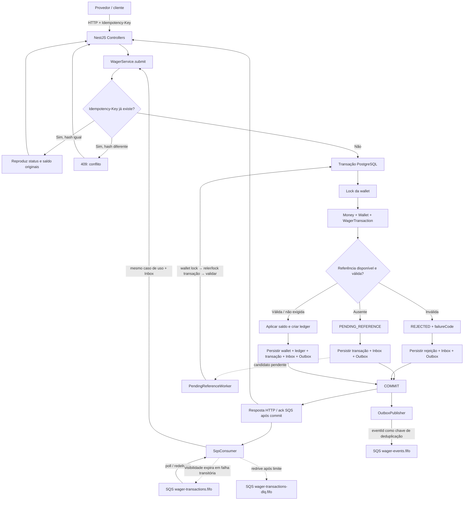

# Decisões de arquitetura

## Limites e fluxo

O serviço usa Bun, TypeScript strict, NestJS, MikroORM, PostgreSQL e SQS via LocalStack. Controllers e workers chamam o mesmo caso de uso (`WagerService.submit`); as classes de domínio (`Money`, `Wallet`, `WagerTransaction` e `WalletLedgerEntry`) validam representação monetária e transições antes da persistência. O domínio não depende de NestJS, MikroORM ou SQS.

As escritas financeiras, Inbox e Outbox passam pelo `EntityManager` recebido em `EntityManager.transactional()` (`tm.execute`). Usar uma conexão fora do contexto transacional pode quebrar atomicidade, locks e consistência.

### Fluxo visual

O ramo de erro de infraestrutura aborta a transação sem confirmar efeitos financeiros; em SQS, a mensagem fica sem ack e pode ser redeliverada. O worker de referência usa a mesma ordem de locks do fluxo HTTP, e o publisher só lê/publica eventos que já foram confirmados na Outbox.

## Dinheiro, wallet e ledger

`Money` mantém centavos em `bigint`; contratos e colunas PostgreSQL usam decimal com escala 2 (`numeric(30,2)`). Não há conversões monetárias para `number`. `Wallet.debit`/`credit` constroem `WalletLedgerEntry` balanceado, atualizam a versão e impedem saldo negativo.

`SELECT ... FOR UPDATE` na wallet é o ponto de serialização por `walletId`. HTTP e worker agora seguem a ordem comum: primeiro lock da wallet, depois lock da transação de referência/pendente. O worker apenas seleciona um candidato sem lock, bloqueia sua wallet e então relê e bloqueia a transação pendente, validando novamente status e vencimento do retry. Assim, candidatos concorrentes podem esperar na wallet sem manter um lock de transação que inverta a ordem. A consulta de reversões ocorre sob o lock da wallet e uma unique partial index em `(reference_transaction_id, kind)` para reversões processadas é a última proteção do banco.

Uma reversão duplicada observada pelo fluxo normal é uma rejeição auditável (`422`, `DUPLICATE_REVERSAL`); `409` fica reservado para conflito de idempotência ou colisão estrutural inesperada.

Constraints PostgreSQL cobrem wallet não negativa e única por player/moeda, transação externa e chave idempotente únicas, ledger balanceado/imutável e no máximo uma reversão processada por tipo e referência. Uma constraint trigger diferida valida no commit que o saldo materializado da wallet é igual à soma assinada de seu ledger e que as moedas coincidem. Essa regra é diferida porque wallet e lançamento precisam ser gravados na mesma transação; a trigger verifica o estado final, não os estados intermediários. Migrations têm `up` e `down`; a migration 003 registra o snapshot de resposta e contexto de correlação, e a 004 adiciona a validação cruzada wallet/ledger.

Reconciliação lê saldo e ledger em uma única instrução SQL (um único snapshot MVCC), calcula `stored - calculated` usando `Money` e não corrige divergências. O endpoint sinaliza `consistent`, diferença e quantidade de entradas; divergências incrementam métrica.

## Idempotência e respostas

O `Idempotency-Key` HTTP é obrigatório. O SHA-256 de JSON canônico usa apenas campos de negócio, sem chave de idempotência nem metadados de transporte. A transação persiste status, saldo, moeda e código de falha originais da resposta; replay não consulta o saldo atual da wallet. Para operações que começam em `PENDING_REFERENCE`, isso significa que o replay sempre reproduz a resposta inicial (`202` e status pendente), mesmo se o worker posteriormente processar ou rejeitar a transação. O estado atual continua disponível em `GET /wagering/transactions/:id`; replay não é uma consulta de status atualizado.

`WIN` pode ser enviado sem referência. Se `referenceExternalTransactionId` vier preenchido, a referência deve existir e apontar para uma `BET` processada da mesma provider/player/wallet/moeda/rodada; o valor do prêmio não precisa ser igual ao valor apostado. Enquanto a `BET` ainda não existir, o `WIN` fica `PENDING_REFERENCE` e o worker aplica a mesma validação depois que ela chegar.

Inbox é única por `(consumer_name, message_id)`, compara o hash e guarda a transação associada. Inbox, transação, saldo, ledger e Outbox são confirmados juntos. O consumer apaga a mensagem somente após o commit; a redelivery depois de commit-before-ack retorna a transação associada sem repetir efeito. Hash divergente é conflito auditável.

O tratamento de `23505` é explícito e limitado: colisão de chave idempotente consulta a transação já confirmada uma vez e retorna replay ou conflito; outros índices únicos viram conflito de persistência/reversão. Não há retry recursivo.

Status HTTP:

| Resultado | HTTP |
|---|---:|
| Transação processada/replay processado | `200` |
| Referência ainda ausente | `202` |
| Rejeição de regra de negócio | `422` |
| Conflito de idempotência ou conflito estrutural de persistência | `409` |
| Payload inválido ou chave ausente | `400` |
| Recurso inexistente | `404` |
| Falha transitória de infraestrutura | `503` |

## Inbox, SQS e Outbox

O consumidor reaproveita o caso de uso HTTP. Conflitos (`409`) e rejeições de negócio (`422`) são registrados e reconhecidos; envelope malformado ou payload inválido (`400`) não é apagado e segue a redrive policy para DLQ; falhas transitórias ficam sem ack e voltam após expirar a visibilidade. Em `SIGTERM`, a aplicação para de receber, espera o processamento atual e aguarda os workers terminarem; mensagens recebidas que ainda não começaram ficam elegíveis para redelivery.

Cada evento de integração é uma classe concreta de `IntegrationEvent`, com `eventType`, versão e envelope persistido completo (`eventId`, `aggregateId`, `correlationId`, `causationId`, `occurredAt`, `version`, `data`). `correlationId`/`causationId` são propagados da requisição ou mensagem SQS. O evento não inclui instâncias de `Money`; valores financeiros são strings decimais.

Os eventos de transação, alteração de saldo e referência pendente são gravados atomicamente com as alterações financeiras. `OutboxPublisher` usa `FOR UPDATE SKIP LOCKED`, publica o envelope persistido após o commit e marca `published_at`; `eventId` também é o `MessageDeduplicationId`. A janela entre publicação e atualização SQL pode duplicar publicação. SQS FIFO reduz duplicatas dentro de sua janela de deduplicação, mas não elimina a possibilidade de uma nova publicação após crash ou após essa janela; consumidores de eventos devem manter deduplicação persistente por `eventId` e tornar o handler idempotente.

A abertura de uma wallet com saldo inicial positivo também é uma transação aplicada: `WagerTransactionProcessed` e `WalletBalanceChanged` são gravados na Outbox junto com a wallet, a transação `OPENING` e o lançamento inicial. A correlação desses eventos internos usa o ID da transação `OPENING`; wallet com saldo inicial zero não cria transação nem evento de abertura.

Referências fora de ordem em `WIN`, `REFUND` e `ROLLBACK` ficam em `PENDING_REFERENCE`, com tentativas e backoff persistidos. O worker seleciona um candidato sem lock de transação, bloqueia a wallet primeiro, relê e bloqueia a transação pendente e revalida status/vencimento; depois bloqueia a referência e revalida as invariantes. Aplica a operação usando classes de domínio e persiste status, ledger e eventos atomicamente. Uma reversão duplicada é rejeitada também no worker.

## Observabilidade e ciclo de vida

- `/health/live` verifica liveness; `/health/ready` verifica PostgreSQL, fila principal e DLQ.
- `/health/metrics` expõe contadores por status, duplicatas, retries, DLQ, conflitos de lock, latência e quantidade/atraso da Outbox.
- Logs JSON incluem correlation/message/transaction/wallet/provider ids nos fluxos de processamento; não registram payloads nem valores financeiros.
- `SIGTERM` e `SIGINT` acionam os hooks de shutdown do NestJS.
- Datas expostas pelo domínio são cópias defensivas; snapshots de `WagerTransaction.toState()` também copiam `createdAt` e `processedAt` para evitar mutação externa do estado interno.

As métricas são em memória para este challenge local. Os nomes `transactions_*_total` contam transições/eventos de processamento, não um snapshot do número atual de linhas em cada status. A profundidade da DLQ só é atualizada durante readiness e é uma aproximação eventualmente consistente. Latência é exposta como contagem, soma e máximo; não há histogramas/percentis. Em produção, exportar para Prometheus/OpenTelemetry, usar histogramas e medir a DLQ por um coletor dedicado.

## Desenvolvimento e validação

Setup, endpoints e comandos reproduzíveis estão no [README.md](./README.md). O desenho de retries e DLQ está em [RETRY_DLQ_ARCHITECTURE.md](./RETRY_DLQ_ARCHITECTURE.md).

Validação mais recente (01/11/2026): Bun 1.4.4, PostgreSQL 16 e LocalStack 3.8; migrations/setup SQS, typecheck e build passaram. Os testes unitários passaram (12). Com integração habilitada, a suíte completa passou com 33 aprovados, 1 fault injection ignorada e 0 falhas. Depois, o teste isolado commit-before-ack também passou (`1 pass, 8 filtered out, 0 fail`). Esta validação foi executada no worktree local; inclui WIN referenciado direto/pendente, LOSS sem lançamento e ROLLBACK de WIN.

## Trade-offs e limitações

- Lock pessimista no banco é simples e correto para operações financeiras; operações em uma wallet hot são serializadas, enquanto wallets distintas avançam em paralelo. O worker seleciona primeiro um candidato sem lock, então usa a mesma ordem wallet → transação; não se mantém lock global entre wallets.
- A Outbox garante publicação eventual, não exactly-once na fronteira PostgreSQL/SQS. A deduplicação por `eventId` é responsabilidade do consumidor.
- As métricas em memória reiniciam com o processo; a profundidade da DLQ e a contagem SQS são aproximadas.
- O backfill de snapshots na migration 003 deriva respostas históricas do ledger disponível; para dados legados sem lançamento ou com timestamps ambíguos, o saldo exato da resposta original não pode ser recuperado. Operações novas persistem o snapshot exato no commit.
- Autenticação externa não foi implementada porque não vale pontos no challenge. `ProviderIdentityPort` existe como interface na fronteira da aplicação (`src/application/ports/provider-identity.port.ts`) para futura resolução/validação da identidade de um provedor por token bearer. Não há implementação, registro no NestJS, guard nem integração com controllers; portanto a interface, sozinha, não protege endpoints. Uma implementação futura OIDC (por exemplo Keycloak/Zitadel) deve validar assinatura, `issuer`, `audience`, expiração e scopes, e derivar `providerId` de claims confiáveis em vez do corpo da requisição. Health permanece aberto conforme o escopo do challenge, e a fila é considerada canal interno confiável.
- O teste de falha artificial após commit e antes do ack é opt-in; veja [RETRY_DLQ_ARCHITECTURE.md](./RETRY_DLQ_ARCHITECTURE.md) para a sequência isolada dos dois terminais e flags necessárias. A suíte completa padrão não executa esse cenário.
